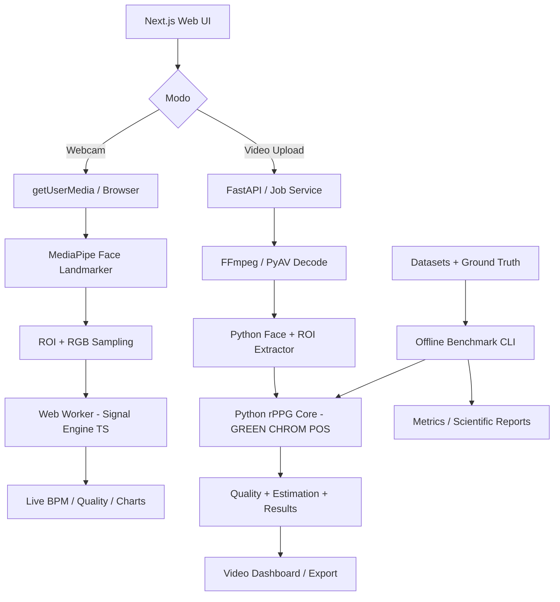

# Projeto 09 — PulseVision: Contactless Heart Rate Estimation Lab

> **Implementation Plan | Versão 1.0 | 07/11/2026**  
> **Repositório sugerido:** `pulsevision-rppg-lab`  
> **Área:** Visão Computacional, Processamento Digital de Sinais, rPPG (remote photoplethysmography)  
> **Objetivo:** portfólio técnico, experimentação científica e preparação para Iniciação Científica em Visão Computacional.

---

## 0. Resumo executivo

Construir uma plataforma experimental que estime **frequência cardíaca (BPM) a partir de pequenas variações de cor na pele facial observadas em vídeo**, usando técnicas de fotopletismografia remota (rPPG). O projeto terá:

1. **Live Lab:** estimativa experimental via webcam, com processamento de pixels e sinal **no navegador**, sem transmissão do vídeo por padrão.
2. **Video Lab:** importação de vídeos gravados, com processamento **local pelo backend Python**, análise temporal e gráficos.
3. **Signal Lab:** visualização das séries RGB, sinal rPPG, espectro de potência, janelas de análise e qualidade do sinal.
4. **Benchmark Lab:** comparação reproduzível dos métodos **GREEN**, **CHROM** e **POS** sobre datasets públicos que possuam referência de frequência cardíaca/PPG.
5. **Experiment Reports:** exportação de parâmetros, métricas, gráficos e dados derivados, com rastreabilidade dos experimentos.

**Princípio do produto:** ser um **laboratório de pesquisa e demonstração**, não um instrumento médico. Não diagnosticar doenças, não gerar alertas de emergência e não alegar precisão clínica sem validação específica.

### 0.1 Por que esse projeto é relevante

O projeto integra de forma verificável:

- Visão computacional: detecção facial, landmarks, segmentação/seleção de pele e acompanhamento de regiões de interesse (ROIs).
- Processamento de sinais: normalização, detrending, filtros digitais, séries temporais, FFT e Welch.
- Métodos rPPG: projeções de crominância, algoritmos clássicos e avaliação de robustez.
- Engenharia de software: frontend interativo, pipeline reprodutível, backend assíncrono, testes e CI.
- Metodologia científica: datasets com *ground truth*, métricas por participante, intervalos de confiança e análise de falhas.

### 0.2 Escopo do MVP e extensões

| Dimensão | MVP obrigatório | Evolução posterior |
|---|---|---|
| Entrada | Webcam local e upload MP4/WebM/MOV suportados pelo decoder | Streams externos, câmeras IP |
| Pessoas | Uma face por sessão | Multi-pessoa com consentimento e isolamento por tracking |
| Algoritmos | GREEN, POS, CHROM | ICA, PCA, SSR, redes neurais |
| Regiões | Testa e bochechas, individualmente e em conjunto | Máscara adaptativa de pele, seleção baseada em qualidade |
| Saídas | BPM estimado, sinal, espectro, qualidade e status | Sinais mais avançados e modelos calibrados |
| Comparação | Vídeo e dataset com *ground truth* | Comparação entre sensores e diferentes câmeras |
| Armazenamento | Metadados locais; vídeos temporários | Histórico persistente opcional |
| Deploy | Local-first, com demonstração controlada | Infraestrutura segura com autenticação |

**Não incluir no MVP:** SpO₂, pressão arterial, diagnóstico de arritmias, estimativa clínica de HRV, monitoramento de recém-nascidos, biometria/identificação facial, reconhecimento de emoções, detecção de doenças e recomendações clínicas.

---

## 1. Resultado esperado e definição de sucesso

### 1.1 Experiência final do usuário

**Fluxo A — Webcam**

1. Usuário abre `/live`, lê a informação de uso experimental e concede permissão à câmera.
2. Interface apresenta preview, detecção de uma face e orientação de posicionamento/iluminação.
3. Sistema seleciona testa/bochechas, extrai RGB médio por frame e constrói buffers temporais locais.
4. Após o preenchimento mínimo da janela de análise, exibe **BPM estimado**, indicador de qualidade, gráfico do sinal, método usado e condições da sessão.
5. Se a qualidade cair, apresenta **“Sinal insuficiente para estimar”** em vez de exibir um número potencialmente enganoso.
6. Usuário pode alternar algoritmo e ROI, pausar, reiniciar e exportar apenas **dados derivados**, mediante ação explícita.

**Fluxo B — Vídeo**

1. Usuário abre `/video`, seleciona arquivo válido e inicia análise.
2. API cria um job, decodifica frames e coleta *timestamps* reais do vídeo.
3. Pipeline acompanha uma face, extrai sinais RGB por ROI, aplica métodos rPPG e calcula estimativas por janela.
4. Interface apresenta timeline com estados de qualidade, estimativas e visualização de trechos selecionados.
5. Usuário exporta resultados CSV/JSON/PNG; o arquivo original é descartado conforme política de retenção.

**Fluxo C — Benchmark**

1. Pesquisador seleciona dataset, sujeitos, condições e métodos.
2. Pipeline lê vídeos e sinais de referência e valida metadados de sincronização.
3. Executa estimativas com configurações registradas, comparando contra a referência no mesmo intervalo temporal.
4. Apresenta MAE, RMSE, correlação, viés, limites de concordância, cobertura válida e custo computacional.
5. Gera tabelas, gráficos e relatório com *seed*, versão do código e parâmetros.

### 1.2 Critérios de sucesso

**Sucesso funcional** (bloqueia entrega do MVP):

- [ ] Webcam inicia/encerra de forma explícita; não grava nem transmite vídeo por padrão.
- [ ] Upload funciona com validação de arquivo, limites de tamanho e processamento não bloqueante.
- [ ] Landmarks e ROIs são desenhados corretamente em imagem e vídeo.
- [ ] GREEN, POS e CHROM retornam sinal/estimativa consistentes com os testes de referência.
- [ ] A interface exibe status de qualidade e **abstém-se de estimar** quando a evidência for insuficiente.
- [ ] Usuário consegue visualizar temporalidade, espectro e o método/ROI configurado.
- [ ] Existe avaliação offline com pelo menos um dataset contendo referência temporal válida.
- [ ] Saídas de experimentos são reproduzíveis e exportáveis.
- [ ] README ensina instalação, uso, limitações e reexecução de benchmark.

**Sucesso científico** (objetivos de pesquisa, **não promessas de precisão**):

- Relatar erros por método, participante, condição e dataset.
- Publicar comparações com **protocolo congelado antes da avaliação final**.
- Apresentar erros e também a **porcentagem de janelas sem estimativa válida**.
- Demonstrar ao menos um experimento de robustez e uma análise de ablação (ROI, janela ou filtro).
- Se estabelecer metas de MAE, fixá-las **após análise exploratória em validação**, antes de testar no conjunto final; não ajustar métricas com base no resultado do teste.

---

## 2. Fundamentos técnicos e decisões de projeto

### 2.1 O que é rPPG

Mudanças discretas na absorção/reflexão de luz pela pele podem produzir variações temporais nos canais de cor de um vídeo. Métodos rPPG tentam isolar componentes relacionadas ao pulso sanguíneo dos efeitos de movimento, iluminação, compressão de vídeo e ruído de câmera.

**BPM estimado** é extraído da frequência dominante de um sinal rPPG considerado suficientemente confiável:

\[
\mathrm{BPM}=60\,f_{\mathrm{pico}},\quad f_{\mathrm{pico}}\ \text{em Hz}.
\]

**Limitação:** uma variação espectral periódica não é, por si só, prova de que foi detectado um pulso real. Interferências de luz e movimento podem produzir picos plausíveis.

### 2.2 Métodos que serão implementados

1. **GREEN (baseline):** utiliza a componente verde normalizada/filtrada do sinal médio da ROI.
2. **CHROM:** combina canais por projeções de crominância conforme método publicado por de Haan e Jeanne (2013).
3. **POS:** utiliza projeção ortogonal ao tom de pele para extrair pulso conforme Wang e colaboradores (2017).

A primeira versão será **determinística e sem treinamento de rede neural**; os modelos de landmarks faciais são pré-treinados, mas o estimador de pulso será implementado com DSP clássico.

### 2.3 Por que MediaPipe, e não YOLO?

**MediaPipe Face Landmarker** é suficiente no MVP para localizar uma face e determinar ROIs faciais estáveis. YOLO não é necessário para a estimativa do pulso. YOLO poderia entrar em cenários futuros com múltiplas pessoas ou detecção especializada, mas não substitui o processamento de sinal rPPG.

### 2.4 Premissas de aquisição

- Câmera RGB convencional, rosto parcialmente frontal, pouca movimentação, iluminação relativamente estável.
- Uma face por sessão.
- Alvo experimental inicial: **30 FPS capturados**, com aferição de FPS efetivo e aceitação de variações documentadas.
- Janela configurável de **20 a 30 segundos** para primeira estimativa estável; passos de atualização menores (por exemplo, 1 a 2 segundos).
- Faixa de pesquisa inicial para busca espectral: **0,7–3,0 Hz** (~42–180 BPM), ajustável conforme protocolo; **não** deve funcionar como critério médico de normalidade.
- Não mostrar um BPM quando o sinal não atender aos critérios de qualidade, mesmo que um pico seja encontrado.

> **Resolução temporal:** uma janela de 20 s tem resolução espectral fundamental aproximada de 0,05 Hz (3 BPM), antes de refinamentos de estimação. *Zero-padding* suaviza a representação espectral, mas não cria informação temporal adicional.

---

## 3. Arquitetura proposta

### 3.1 Visão geral



### 3.2 Separação de responsabilidades

**Frontend — Next.js/TypeScript**

- Entrada de câmera com `getUserMedia` em contexto seguro e consentimento do navegador.
- Preview, overlays, indicadores, gráficos e controles interativos.
- Detecção de landmarks com MediaPipe para fluxo ao vivo.
- Extração de RGB médio e máscara de pele no navegador, com otimizações de Canvas/WebGL conforme necessidade.
- Processamento de sinais ao vivo em módulo TypeScript e, quando suportado, Web Worker.
- Nenhum streaming do vídeo bruto para o backend no modo webcam.

**Backend — FastAPI/Python**

- Processamento e análise de **arquivos enviados voluntariamente**.
- Decodificação temporal, detecção facial, rastreamento de ROIs, pipeline rPPG e métricas.
- API de jobs, status, resultados e exportações.
- Persistência local temporária com limpeza automática.

**Scientific Core — Python sem dependência de HTTP**

- Métodos GREEN, CHROM, POS de referência do projeto.
- Filtros, janelamento, espectro, estimativa, qualidade e métricas.
- Benchmark e reprodutibilidade.
- Testes com sinais sintéticos e datasets validados.

**Regra arquitetural:** o TypeScript e o Python devem seguir as **mesmas especificações numéricas** e passar em testes de equivalência em séries RGB artificiais. Diferenças esperadas de precisão numérica devem ser documentadas.

### 3.3 Por que abordagem híbrida

- **Webcam no cliente:** reduz exposição de imagens faciais e evita custo de transmissão contínua.
- **Análise offline em Python:** facilita experimentos científicos com NumPy, SciPy, OpenCV, métricas e datasets.
- **Mesmo protocolo:** ajuda a comparar comportamento em tempo real e offline sem confundir diferenças de algoritmo com diferenças de aquisição.

### 3.4 Stack técnica

| Camada | Tecnologia | Papel |
|---|---|---|
| Web | Next.js, TypeScript | UI e integração |
| Design | Tailwind CSS, shadcn/ui | Componentes e layout |
| Gráficos | Plotly.js / Recharts | RGB, rPPG, PSD, BPM temporal |
| Câmera | MediaDevices, Canvas, Web Workers | Captura e extração local |
| Face landmarks | MediaPipe Face Landmarker | Rosto e ROIs |
| API | Python, FastAPI, Pydantic | Upload, jobs e resultados |
| Vídeo | FFmpeg, PyAV ou OpenCV | Decodificação e timestamps |
| DSP | NumPy, SciPy | Filtros, FFT/Welch, normalização |
| Visão | OpenCV, MediaPipe Python | Face e ROIs em vídeos |
| Métricas | NumPy, SciPy, pandas | Métricas e estatísticas |
| Testes | pytest, Vitest, Playwright | Unitário, contrato, E2E |
| Qualidade | Ruff, ESLint, typecheck | Padrões de código |
| CI | GitHub Actions | Testes e verificações |
| Experimentos | YAML + JSON + CSV (MLflow opcional) | Configurações e resultados |

**Hardware:** execução inicial em CPU; RTX 3050 6 GB fica reservada para benchmarks de redes neurais e otimizações futuras. Não criar dependência artificial de CUDA no MVP.

---

## 4. Pipeline de processamento — especificação obrigatória

```text
Video / Camera
  -> Timestamped frame
  -> Face detection / landmarks
  -> Face validity + motion tracking
  -> Forehead / cheeks skin regions
  -> RGB summary per region and timestamp
  -> Temporal buffering
  -> Detrend / normalize / resample if necessary
  -> GREEN | CHROM | POS
  -> Band-pass filtering / valid frequency selection
  -> Welch PSD or FFT with documented settings
  -> Peak selection + signal-quality gates
  -> BPM estimate OR no-estimate
  -> Charts / metrics / export
```

### 4.1 Captura e temporização

**Requisitos**

- Cada amostra deve manter `{timestamp_s, r_mean, g_mean, b_mean, roi_id, quality_flags}`.
- Nunca supor que cada frame foi capturado exatamente a 1/30 s.
- Webcam: usar tempo monotônico de captura/apresentação, registrar saltos de frame e FPS efetivo por janela.
- Arquivo: usar *presentation timestamps* (PTS) reais do container quando disponíveis, não apenas índice de frame.
- Lidar com FPS variável, duplicação, ausência de timestamps, vídeos corrompidos e *seek*.
- Reamostrar para base temporal uniforme somente quando necessário; documentar método e frequência-alvo, evitando interpolar lacunas longas como se fossem evidência.

**DoD:** testes com vídeos CFR e VFR; gráfico/diagnóstico de frequência amostral real; ausências geram marcadores de qualidade.

### 4.2 Detecção de rosto e ROIs

**ROIs iniciais**

- Testa, excluindo cabelos e sobrancelhas.
- Bochecha esquerda e direita, excluindo olhos, boca e bordas da face.
- Composição ponderada das regiões válidas.

**Regras**

- Rastrear ROIs de frame a frame a partir de landmarks e geometria facial.
- Definir polígonos faciais em coordenadas de imagem com validação dos limites.
- Excluir áreas com sombra intensa, especularidade/saturação, olhos, boca e fundo.
- Em caso de oclusão, rosto ausente ou mudança brusca de escala, descartar janela prejudicada.
- Não inferir identidade, etnia, condições de saúde ou atributos sensíveis a partir do rosto.
- Inspecionar amostras em condições de iluminação e tons de pele variados sem usar inferências demográficas não consentidas.

**DoD:** testes de geometrias; ROI consistente ao mover ligeiramente a cabeça; flags quando face/ROI deixa de ser confiável.

### 4.3 Extração RGB

- Converter corretamente espaço de cor da imagem de entrada (ex.: BGR → RGB no OpenCV).
- Aplicar máscara de ROI para calcular médias robustas de R/G/B.
- Calcular fração de pixels válidos, saturados ou escuros.
- Registrar iluminação média e variação temporal.
- Separar sinais por ROI para futuras ablações.
- Rejeitar amostras com poucas áreas válidas.

**Contrato mínimo**

```json
{
  "timestamp_s": 12.533,
  "roi": "left_cheek",
  "rgb_mean": [123.4, 98.7, 87.2],
  "valid_pixel_fraction": 0.93,
  "landmark_status": "ok",
  "motion_score": 0.08
}
```

### 4.4 Processamento de sinais

1. Selecionar janelas temporais válidas com duração configurável.
2. Avaliar integridade de timestamps e amostras faltantes.
3. Corrigir tendência lenta (*detrending*) quando adequado.
4. Normalizar canais RGB com método e escala documentados.
5. Aplicar método rPPG selecionado.
6. Realizar filtragem digital com implementação estável (preferência: Butterworth com SOS em Python) e sinalizar efeitos de borda.
7. Estimar PSD com Welch ou FFT sob configurações controladas.
8. Buscar frequência candidata no intervalo definido, verificar picos espúrios/harmônicos.
9. Aplicar regras de qualidade e retornar BPM **ou abstenção**.

**Atenção à causalidade:** filtro `filtfilt` é adequado para análise *offline*, mas usa amostras futuras. No modo ao vivo, implementar filtro causal/estratégia compatível e documentar a diferença. Não apresentar estimativa *offline* como se fosse obtida em tempo real com a mesma latência.

### 4.5 Métodos rPPG

**GREEN**

- Linha de base mais simples.
- Extrair canal G e aplicar processamento consistente com os demais, mantendo documentada a normalização.
- Validar a detecção espectral em dados sintéticos.

**CHROM**

- Implementar projeção de crominância conforme referência original.
- Calcular escala relativa de componentes com parâmetros e janelas definidas.
- Validar sinal e estimativa contra implementação conhecida em dados controlados.

**POS**

- Implementar combinações de projeção ortogonal ao tom de pele conforme referência original.
- Tratar corretamente janelas, normalização e composição/overlap-add.
- Registrar a diferença entre implementação de referência (offline) e variante causal/live, caso exista.

**Padrão de interface do algoritmo**

```python
class RPPGMethod(Protocol):
    name: str
    def extract(self, rgb: np.ndarray, timestamps_s: np.ndarray, config: dict) -> np.ndarray:
        """Return one rPPG sample per input timestamp, or raise a typed signal-quality error."""
```

> A interface acima é um **contrato conceitual**, não código final: métodos janelados precisam informar validade das bordas e possíveis perdas temporais.

### 4.6 Qualidade de sinal e abstenção

Criar `SignalQualityService` com verificações independentes:

- Face detectada e apenas uma face válida.
- Fração de pixels válidos por ROI.
- Oscilação de iluminação e saturação.
- Magnitude de movimento facial e estabilidade das ROIs.
- FPS efetivo, lacunas e irregularidade amostral.
- Energia espectral na faixa de interesse versus fora dela.
- Dominância do pico, dispersão e estabilidade entre janelas.
- Consistência entre ROIs e, quando disponível, entre métodos.

**Saídas permitidas:** `warming_up`, `good`, `degraded`, `unreliable`, `no_face`, `insufficient_data`, `unsupported_video`.

**Regra obrigatória:** **não preencher buracos com BPM anterior sem indicar obsolescência**. Se o sinal for ruim, mostrar `—` e causa. Um score heurístico é **qualidade instrumental**, não probabilidade clínica de acerto.

### 4.7 Estimação e suavização

- Processar janelas sobrepostas configuráveis de 20–30 s.
- Passo de atualização: 1–2 s, após aquecimento.
- Exibir estimativa com marca temporal e idade da amostra.
- Se houver suavização entre janelas, registrar algoritmo e duração para não mascarar mudanças reais.
- Não inferir batimentos individuais com precisão a partir apenas do valor espectral.

---

## 5. Interface — especificação do produto

### 5.1 Direção visual

- Aplicação **desktop-first**, responsiva para tablet, com tema dark e acentos azul/ciano.
- Aparência de laboratório científico: legibilidade de números, escalas e unidades; estética profissional, sem elementos médicos enganosos.
- Feedback sem cores como única pista (texto + ícones de estado + explicação).
- Português como idioma inicial; strings centralizadas para permitir versão em inglês no portfólio.
- Gráficos com cursor temporal, tooltips, zoom e exportação.

### 5.2 Navegação

| Rota | Tela | Função |
|---|---|---|
| `/` | Overview | Explicação, limites, atalhos e estado do sistema |
| `/live` | Live Lab | Webcam, ROIs, frequência estimada, qualidade e gráficos |
| `/video` | Video Lab | Upload, processamento e timeline |
| `/signals` | Signal Lab | Visualização comparada RGB, rPPG e espectro |
| `/benchmarks` | Benchmark Lab | Experimentos e métricas |
| `/benchmarks/[id]` | Experiment Detail | Resultados e artefatos |
| `/settings` | Settings | Webcam, algoritmo, janelas, privacidade e exportação |
| `/about` | Methodology | Referências, metodologia e limitações |

### 5.3 Live Lab — layout de referência

```text
┌──────────────────────────────────────────────────────────────────────────────┐
│ PulseVision                       Live Lab   Video   Signals   Benchmarks   │
├───────────────────────────────┬─────────────────────┬────────────────────────┤
│ Camera Preview                │ ESTIMATED HR        │ SIGNAL QUALITY         │
│  • Facial landmark overlay    │  73 BPM*            │ Good / Degraded        │
│  • Forehead/Cheek ROI overlay │ Method: POS         │ Reason + FPS + motion  │
│  • Positioning guide          │ Window: 25s        │ Valid pixels: 96%      │
├───────────────────────────────┴─────────────────────┴────────────────────────┤
│ rPPG Signal: time-domain waveform (units arbitrary)                         │
├──────────────────────────────────────────────┬───────────────────────────────┤
│ PSD / Frequency peak                         │ Time series of BPM estimates │
├──────────────────────────────────────────────┴───────────────────────────────┤
│ Source: Webcam | ROI: Forehead/Cheeks | Method: POS | Start / Pause / Stop   │
│ Experimental only — not for diagnosis or emergencies.                       │
└──────────────────────────────────────────────────────────────────────────────┘
* Número ilustrativo; nunca demonstrar como resultado real sem processamento.
```

**Componentes**

- `CameraPreview`: permissão, seleção de dispositivo, start/stop, indicadores.
- `FaceRoiOverlay`: polígonos de testa/bochechas e estado de tracking.
- `HeartRateCard`: BPM, janela, método, status, timestamp e símbolo de estimativa.
- `SignalQualityPanel`: explicações dos critérios de confiabilidade.
- `RppgWaveformChart`: sinal estimado ao longo do tempo.
- `SpectrumChart`: PSD e frequência candidata.
- `RealtimeBpmChart`: série temporal de estimativas válidas.
- `SessionControls`: iniciar, pausar, limpar, exportar derivados.
- `MethodConfigurator`: GREEN / CHROM / POS, ROI e parâmetros permitidos.

**Estados de UX obrigatórios**

- Antes da permissão.
- Permissão negada ou dispositivo indisponível.
- Inicializando detector.
- Face não encontrada / múltiplas faces.
- Aquecimento e preenchimento da janela.
- Sinal confiável o suficiente para estimativa.
- Sinal degradado ou insuficiente.
- Câmera interrompida ou aba em segundo plano.

### 5.4 Video Lab

- Dropzone para arquivos locais e exibição de metadados (duração, codec, resolução, FPS nominal, tamanho).
- Informação clara sobre envio para o backend local ou remoto, conforme configuração.
- Barra de progresso e estados `queued`, `processing`, `completed`, `failed`, `cancelled`.
- Preview e timeline navegável com regiões válidas/inválidas.
- ROI original, RGB bruto, sinal rPPG, PSD, BPM por janela.
- Filtros por método e ROI; comparação visual e estatística.
- Exportação explicitamente solicitada.
- Ação de descarte de vídeo/resultados.

### 5.5 Benchmark Lab

- Tabela por dataset, sujeito, condição e método.
- MAE, RMSE, correlação, cobertura de janelas e inferência.
- Gráfico estimado x referência; erro ao longo do tempo; Bland–Altman.
- Distribuição de erros e tabela com resultados por participante.
- Controle de configuração experimental e link a artefatos de reprodução.
- Quando não houver referência temporal confiável, não computar métrica que dependa dela.

---

## 6. Estrutura do repositório

```text
pulsevision-rppg-lab/
├── apps/
│   └── web/
│       ├── app/
│       │   ├── (dashboard)/live/
│       │   ├── (dashboard)/video/
│       │   ├── (dashboard)/signals/
│       │   ├── (dashboard)/benchmarks/
│       │   ├── (dashboard)/settings/
│       │   └── about/
│       ├── components/
│       │   ├── camera/
│       │   ├── charts/
│       │   ├── signals/
│       │   ├── quality/
│       │   └── layout/
│       ├── features/
│       │   ├── camera/
│       │   ├── face-roi/
│       │   ├── live-rppg/
│       │   ├── video-jobs/
│       │   └── benchmarks/
│       ├── workers/
│       ├── lib/api/
│       ├── lib/signal/
│       ├── tests/
│       └── package.json
├── services/
│   └── api/
│       ├── app/
│       │   ├── api/routes/
│       │   ├── core/
│       │   ├── services/
│       │   ├── jobs/
│       │   ├── schemas/
│       │   └── security/
│       └── tests/
├── packages/
│   ├── rppg_core/
│   │   ├── acquisition/
│   │   ├── face/
│   │   ├── roi/
│   │   ├── signals/
│   │   ├── methods/
│   │   │   ├── green.py
│   │   │   ├── chrom.py
│   │   │   └── pos.py
│   │   ├── quality/
│   │   ├── estimation/
│   │   ├── metrics/
│   │   └── tests/
│   └── rppg_types/
├── benchmarks/
│   ├── adapters/
│   ├── configs/
│   ├── protocols/
│   ├── runners/
│   ├── analysis/
│   └── reports/
├── scripts/
├── configs/
├── docs/
│   ├── architecture/
│   ├── research/
│   ├── privacy/
│   ├── evaluation/
│   └── adrs/
├── tests/
│   └── fixtures/
├── .github/workflows/
├── pyproject.toml
├── uv.lock
├── README.md
├── LICENSE
└── .gitignore
```

**Diretórios fora do Git:** `data/raw/`, `data/ground_truth/`, `artifacts/`, `uploads/`, `models/` quando a licença não permitir redistribuição ou os arquivos forem grandes/sensíveis.

---

## 7. Plano de implementação por ondas

> **Ordem recomendada:** primeiro consolidar um **núcleo offline mensurável**, depois construir vídeo e webcam. Isso evita criar uma interface vistosa sem saber se as estimativas são tecnicamente válidas.
>
> Cada onda deve terminar com uma PR pequena ou um conjunto de PRs coerentes, testes e uma demonstração objetiva.

### ONDA 0 — Foundation, segurança e protocolo científico

**Objetivo:** criar base estável, restrições e contrato de avaliação antes de escrever algoritmos.

**Tarefas**

- [ ] `PV-0001` Criar monorepo e convenções de pastas.
- [ ] `PV-0002` Configurar Python 3.11/3.12 compatível, `uv`, `ruff`, `pytest`, lockfile.
- [ ] `PV-0003` Inicializar Next.js/TypeScript, Tailwind, shadcn/ui, ESLint, formatter e Vitest.
- [ ] `PV-0004` Configurar CI: lint, typecheck, unit tests e build.
- [ ] `PV-0005` Escrever `docs/architecture/overview.md` com ADR de processamento híbrido.
- [ ] `PV-0006` Escrever política de privacidade: webcam sem upload padrão, retenção e exclusão para arquivos enviados.
- [ ] `PV-0007` Definir schemas: amostra RGB, janela, estimativa, status e experimento.
- [ ] `PV-0008` Criar `docs/evaluation/protocol-v1.md`, congelando regra de particionamento, métricas, alinhamento temporal, abstenção e uso de *ground truth*.
- [ ] `PV-0009` Definir licença do código e política para datasets/modelos de terceiros.

**Entregáveis:** monorepo compilável, CI verde, arquitetura registrada, protocolo metodológico inicial.

**DoD:** setup documentado em Fedora/Linux; teste e build passam; proibição de commit de vídeos/dados sensíveis aplicada no `.gitignore`.

**Dependências:** nenhuma.

### ONDA 1 — Video ingestion e contratos temporais

**Objetivo:** conseguir ler vídeo e produzir frames com timestamps corretos.

**Tarefas**

- [ ] `PV-0101` Criar `VideoReader` com suporte aos containers de teste selecionados (MP4/WebM/MOV conforme codecs presentes).
- [ ] `PV-0102` Extrair duração, resolução, orientação, metadados de tempo e FPS nominal.
- [ ] `PV-0103` Decodificar frames com PTS; tratar VFR e frames duplicados.
- [ ] `PV-0104` Padronizar saída `FrameSample` com timestamp monotônico em segundos.
- [ ] `PV-0105` Definir política para vídeos sem timestamps válidos, codecs incompatíveis e arquivos truncados.
- [ ] `PV-0106` Criar fixtures curtas próprias/sintéticas com CFR, VFR e cor constante.
- [ ] `PV-0107` Testar aquisição e integridade temporal (ordenação, duração, saltos, total de frames).

**Entregáveis:** CLI `python -m rppg_core.acquisition.inspect_video <arquivo>`; relatório de metadados e sequência temporal.

**DoD:** suporte testado para os formatos adotados; entradas inválidas produzem erro tipado e claro, não valores silenciosos.

**Dependências:** Onda 0.

### ONDA 2 — Face detection, ROI tracking e sinais RGB

**Objetivo:** transformar vídeo em séries temporais RGB por região facial.

**Tarefas**

- [ ] `PV-0201` Integrar MediaPipe Face Landmarker em Python para processamento offline.
- [ ] `PV-0202` Criar configuração `single_face_only=true` e sinalizar múltiplas faces.
- [ ] `PV-0203` Definir polígonos de testa, bochecha esquerda e bochecha direita usando landmarks.
- [ ] `PV-0204` Criar máscaras e exclusões (olhos, boca, cabelos e bordas quando detectáveis).
- [ ] `PV-0205` Extrair média RGB válida e estatísticas de cada ROI por timestamp.
- [ ] `PV-0206` Calcular flags de brilho, saturação, estabilidade geométrica e área visível.
- [ ] `PV-0207` Tratar ausência de face, perda de tracking e eventos de movimento.
- [ ] `PV-0208` Salvar `rgb_traces.csv` e um preview opcional de ROIs (apenas quando autorizado).
- [ ] `PV-0209` Criar testes unitários de geometria e de conversão BGR/RGB.

**Entregáveis:** CLI de extração de sinais; CSV com amostras válidas e metadados de qualidade.

**DoD:** ROIs corretas em fixtures; sem amostras falsas quando a face desaparece; integra corretamente ao `VideoReader`.

**Dependências:** Onda 1.

### ONDA 3 — Signal Processing Core + GREEN

**Objetivo:** obter o primeiro BPM estimado com referência sintética e controle de qualidade básico.

**Tarefas**

- [ ] `PV-0301` Implementar resampling temporal e tratamento de lacunas com limites explícitos.
- [ ] `PV-0302` Implementar normalização, detrending e janelação.
- [ ] `PV-0303` Implementar filtros passa-faixa numericamente estáveis.
- [ ] `PV-0304` Implementar estimador espectral Welch/FFT, localização de pico e conversão Hz → BPM.
- [ ] `PV-0305` Implementar método GREEN.
- [ ] `PV-0306` Criar gerador de traços RGB sintéticos com frequência conhecida e diferentes níveis de ruído.
- [ ] `PV-0307` Testar frequências, harmônicos, sinais constantes, períodos curtos, Nyquist, NaNs e lacunas.
- [ ] `PV-0308` Definir retorno `EstimateResult` com BPM opcional, janela, método, status e metadados.

**Entregáveis:** pipeline offline `RGB traces -> GREEN -> BPM/abstention` com gráficos básicos em PNG.

**DoD:** acerta casos sintéticos dentro de tolerância definida por resolução temporal; não emite BPM para sinais constantes/inválidos.

**Dependências:** Onda 2.

### ONDA 4 — CHROM, POS e equivalência entre métodos

**Objetivo:** comparar três métodos clássicos sob o mesmo protocolo.

**Tarefas**

- [ ] `PV-0401` Implementar CHROM com referência bibliográfica e testes.
- [ ] `PV-0402` Implementar POS com composição adequada de janelas.
- [ ] `PV-0403` Criar fábrica de métodos (`method_registry`) e configurações versionadas.
- [ ] `PV-0404` Garantir mesmas condições de janelas, ROIs e sinal de entrada em comparações justas.
- [ ] `PV-0405` Implementar geração de sinais, espectros e BPM ao longo do tempo.
- [ ] `PV-0406` Comparar resultados com implementações de referência (pyVHR/rPPG-Toolbox) **nas mesmas entradas e parâmetros**.
- [ ] `PV-0407` Documentar diferenças de filtragem e borda entre implementações.
- [ ] `PV-0408` Criar teste automático de regressão numérica por algoritmo.

**Entregáveis:** núcleo clássico GREEN/CHROM/POS, reproduzível e testado.

**DoD:** métodos retornam valores finitos ou erro de qualidade explícito; comparação documentada; testes de regressão passam.

**Dependências:** Onda 3.

### ONDA 5 — Qualidade de sinal e política de abstenção

**Objetivo:** diminuir exibição de resultados enganosos.

**Tarefas**

- [ ] `PV-0501` Implementar indicadores de validade da face e ROIs.
- [ ] `PV-0502` Incorporar movimento, iluminação, cobertura temporal e qualidade espectral.
- [ ] `PV-0503` Criar estados e *reason codes* detalhados.
- [ ] `PV-0504` Definir gates iniciais heurísticos em configuração (sem alegar calibração clínica).
- [ ] `PV-0505` Criar validação de qualidade em janelas consecutivas.
- [ ] `PV-0506` Implementar política de valores obsoletos: nunca reapresentar como atuais.
- [ ] `PV-0507` Testar cenários adversos: face ausente, movimento amplo, piscadas de luz, FPS irregular, ruído e saturação.
- [ ] `PV-0508` Medir **coverage**: porcentagem de janelas com estimativas aceitas.

**Entregáveis:** estimador com `BPM | null` e motivo auditável.

**DoD:** dados claramente inválidos não resultam em número; abstenções são contabilizadas no benchmark.

**Dependências:** Ondas 3–4.

### ONDA 6 — Datasets, *ground truth* e benchmark científico

**Objetivo:** avaliar o núcleo em dados reais, com referência sincronizada.

**Tarefas**

- [ ] `PV-0601` Verificar acesso, termos de uso e estrutura de UBFC-rPPG.
- [ ] `PV-0602` Criar adapter UBFC-rPPG (vídeo, sinal de referência e timestamps).
- [ ] `PV-0603` Preparar suporte PURE se acesso autorizado; documentar solicitação e licença.
- [ ] `PV-0604` Definir protocolo por participante/sessão, sem vazamento de dados entre validação e teste.
- [ ] `PV-0605` Implementar sincronização temporal vídeo–referência; recusar métricas quando a sincronização não for confiável.
- [ ] `PV-0606` Definir estimativa de HR de referência usando regra documentada e mesmas janelas.
- [ ] `PV-0607` Implementar MAE, RMSE, mediana do erro absoluto, viés, correlação, cobertura e tempos.
- [ ] `PV-0608` Implementar Bland–Altman, dispersão estimado × referência e distribuição por sujeito.
- [ ] `PV-0609` Agregar por participante antes da síntese final e calcular intervalos de confiança por reamostragem de participantes, quando amostra permitir.
- [ ] `PV-0610` Executar GREEN/CHROM/POS com parâmetros congelados e exportar relatório.
- [ ] `PV-0611` Investigar falhas e registrar quando a referência não suporta determinada conclusão.
- [ ] `PV-0612` Conferir limites de licença: não commitar datasets, rostos ou sinais brutos restritos.

**Entregáveis:** tabelas comparativas e relatório científico `benchmark-v1`, além de runner em CLI.

**DoD:** script reproduz resultados a partir de datasets obtidos legitimamente; nenhuma métrica sem referência/alinhamento válido; cobertura e exclusões relatadas.

**Dependências:** Ondas 2–5.

### ONDA 7 — Backend FastAPI e processamento assíncrono

**Objetivo:** disponibilizar análise de upload sem bloquear requisições web.

**Tarefas**

- [ ] `PV-0701` Criar API FastAPI, healthcheck e schema OpenAPI.
- [ ] `PV-0702` Implementar upload com streaming, limite de tamanho, MIME real, inspeção de codec e caminho seguro.
- [ ] `PV-0703` Criar fila local simples com worker dedicado/processo separado, fora do request lifecycle; substituir por Redis/RQ somente se necessário.
- [ ] `PV-0704` Implementar ciclo de vida de job: `queued/processing/completed/failed/cancelled/expired`.
- [ ] `PV-0705` Implementar cancelamento e isolamento de arquivos temporários por job.
- [ ] `PV-0706` Criar endpoint de status/progresso e resultados com paginação/decimação de séries longas.
- [ ] `PV-0707` Implementar exportação derivada CSV/JSON e gráficos.
- [ ] `PV-0708` Aplicar timeout, limites de duração, dimensão, FPS, CPU/RAM e rate limiting quando exposta.
- [ ] `PV-0709` Criar política de limpeza para uploads/jobs e endpoint de exclusão explícita.
- [ ] `PV-0710` Testes de integração API com arquivos válidos, truncados e uploads concorrentes.

**Entregáveis:** API local para vídeos com contrato estável.

**DoD:** jobs longos não bloqueiam healthcheck; falhas não deixam vídeos órfãos; API não permite path traversal nem execução arbitrária.

**Dependências:** Ondas 1–5.

### ONDA 8 — UI de Video Lab, gráficos e resultados

**Objetivo:** tornar o núcleo utilizável sem CLI.

**Tarefas**

- [ ] `PV-0801` Criar shell, navegação, tema e design system.
- [ ] `PV-0802` Implementar upload e validação client-side de vídeo.
- [ ] `PV-0803` Integrar submissão do job, status, cancelamento e tratamento de erro.
- [ ] `PV-0804` Criar painel de resultados com BPM temporal, PSD e rPPG.
- [ ] `PV-0805` Criar visualizador de ROI e timeline sincronizada ao vídeo original.
- [ ] `PV-0806` Criar seletor de método e ROI com recálculo de experimentos quando necessário.
- [ ] `PV-0807` Implementar exportação explícita.
- [ ] `PV-0808` Criar estados vazios, erro, sem face, sem estimativa, processando e concluído.
- [ ] `PV-0809` Implementar acessibilidade, navegação por teclado e labels nos gráficos.
- [ ] `PV-0810` Executar E2E de upload → processamento → revisão → exportação → exclusão.

**Entregáveis:** Video Lab funcional em Next.js.

**DoD:** usuário completa fluxo de vídeo sem terminal; todos os estados de baixa qualidade são compreensíveis.

**Dependências:** Onda 7.

### ONDA 9 — Webcam ao vivo: MediaPipe + DSP no navegador

**Objetivo:** implementar estimativa **client-side** com feedback visual e estados de qualidade.

**Tarefas**

- [ ] `PV-0901` Integrar `getUserMedia`, seleção de câmera e liberação de tracks no Stop/unmount.
- [ ] `PV-0902` Integrar MediaPipe Face Landmarker em modo vídeo, com uso de timestamps.
- [ ] `PV-0903` Implementar ROIs no canvas/preview alinhadas ao vídeo real e efeitos de espelhamento.
- [ ] `PV-0904` Extrair médias RGB e indicadores de qualidade por frame no browser.
- [ ] `PV-0905` Criar ring buffer por ROI, com tamanho e descarte controlados.
- [ ] `PV-0906` Implementar GREEN e POS ou CHROM primeiro em TypeScript e completar os demais após equivalência.
- [ ] `PV-0907` Implementar processamento assíncrono/cadência sem travar o preview; usar Web Worker quando possível.
- [ ] `PV-0908` Reproduzir testes sintéticos compartilhados Python ↔ TypeScript.
- [ ] `PV-0909` Criar state machine: permission → detector → warm-up → result/abstention → stopped.
- [ ] `PV-0910` Implementar Live Lab com preview, overlays, BPM estimado, status, sinal, PSD e parâmetros.
- [ ] `PV-0911` Testar perda de foco, mudança de câmera, dispositivo removido, refresh e ausência de rosto.
- [ ] `PV-0912` Confirmar via testes de rede que frames de webcam não são enviados por padrão.
- [ ] `PV-0913` Exportar séries derivadas apenas com ação explícita do usuário.

**Entregáveis:** live demo local com webcam e sinais/estimativas de qualidade.

**DoD:** preview responsivo; câmera desligada corretamente; nenhum vídeo enviado sem ação; resultados inválidos são suprimidos; regressões Python/TS documentadas.

**Dependências:** Ondas 2–5 para definição, Onda 8 para componentes visuais compartilhados.

**Nota técnica:** as rotinas de Face Landmarker em JavaScript podem bloquear a thread chamadora; planejar execução com worker quando suportado ou redução da cadência de detecção, sem confundir FPS exibido e FPS realmente analisado.

### ONDA 10 — Experimentos, relatórios e análise de robustez

**Objetivo:** transformar o sistema em plataforma de portfólio com valor científico.

**Tarefas**

- [ ] `PV-1001` Criar Benchmark Lab visual consumindo resultados offline.
- [ ] `PV-1002` Implementar gráficos por método, sujeito, ROI e cenário.
- [ ] `PV-1003` Automatizar relatórios Markdown e figuras em PNG.
- [ ] `PV-1004` Experimento A — GREEN vs CHROM vs POS em dataset com referência.
- [ ] `PV-1005` Experimento B — testa vs bochechas vs combinação.
- [ ] `PV-1006` Experimento C — janela 10/20/30 s: latência, MAE e cobertura.
- [ ] `PV-1007` Experimento D — ruído, desfoque, mudança de luz e compressão, com alterações controladas e verificáveis.
- [ ] `PV-1008` Experimento E — movimento facial, variação de FPS e frames faltantes.
- [ ] `PV-1009` Registrar configurações, seeds, versão de dependências, hashes e critérios de exclusão.
- [ ] `PV-1010` Elaborar relatório final com hipóteses, metodologia, resultados, limitações e trabalhos futuros.

**Entregáveis:** pacote de experimentos reproduzíveis e versão de apresentação acadêmica.

**DoD:** cada tabela tem origem, código, protocolo e condições; não há gráfico sem legenda/unidades nem afirmação sem evidência.

**Dependências:** Onda 6 + Onda 8; webcam Onda 9 quando incluída na análise.

### ONDA 11 — Polish, release e apresentação do portfólio

**Objetivo:** publicar uma versão estável demonstrável e bem documentada.

**Tarefas**

- [ ] `PV-1101` Revisar UI/UX, contraste, escalas, estados e responsividade.
- [ ] `PV-1102` Atingir cobertura suficiente nos módulos críticos (testes orientados a risco, sem inflar cobertura artificialmente).
- [ ] `PV-1103` Executar análise de dependências e segurança de uploads.
- [ ] `PV-1104` Criar Docker Compose local opcional (web/API/worker) sem expor diretórios sensíveis.
- [ ] `PV-1105` Documentar instalação e execução no Fedora/Linux, incluindo permissões de câmera.
- [ ] `PV-1106` Publicar README em inglês e resumo em português com screenshots autorizadas.
- [ ] `PV-1107` Criar `docs/research/report.md` e citar corretamente datasets/artigos.
- [ ] `PV-1108` Gravar demo curta com vídeo próprio/autorizado ou sintético.
- [ ] `PV-1109` Adicionar versão `v1.0.0`, changelog e lista de limitações.

**Entregáveis:** MVP publicado e portfólio pronto para conversa com orientador.

**DoD:** instalação reproduzível; arquivos sensíveis ausentes do Git; todas as restrições de uso explicitadas; demo com resultados reais ou claramente ilustrativos.

**Dependências:** Ondas 0–10.

---

## 8. Dependências e marcos de entrega

| Marco | Ondas | Evidência objetiva | Bloqueia próximo marco? |
|---|---|---|---|
| M0 — Base pronta | 0 | CI, protocolos, schemas | Sim |
| M1 — RGB confiável | 1–2 | timestamps + traces RGB por ROI | Sim |
| M2 — Estimador clássico | 3–5 | GREEN/CHROM/POS e abstenção | Sim |
| M3 — Validação científica | 6 | benchmark com *ground truth* | Sim para alegações de desempenho |
| M4 — Produto offline | 7–8 | upload, análise, gráficos | Não para webcam |
| M5 — Produto live | 9 | câmera sem envio de vídeo, BPM/qualidade | Não para benchmark |
| M6 — Relatório final | 10–11 | experimentos e release | Conclusão |

**Trabalho em paralelo permitido:** design system e mock de gráficos podem começar após M0; integração real deve seguir o contrato de sinais. Webcam não deve ser a primeira fonte de validação científica, pois o próprio valor de referência é desconhecido.

### 8.1 Priorização para esforço limitado

**P0:** Ondas 0–6 (núcleo científico); 7–9 (webcam e upload); UI essencial de 8.  
**P1:** dashboards completos, relatórios avançados, robustez e ablações da Onda 10.  
**P2:** containers e refinamentos opcionais, integração de novos datasets, novas metodologias.

---

## 9. Contratos de dados e APIs

### 9.1 Tipos de domínio

```typescript
type SignalQualityStatus =
  | "warming_up"
  | "good"
  | "degraded"
  | "unreliable"
  | "no_face"
  | "insufficient_data"
  | "unsupported_video";

type RppgMethod = "green" | "chrom" | "pos";

type RoiId = "forehead" | "left_cheek" | "right_cheek" | "combined";

interface RppgEstimate {
  timestampS: number;
  windowStartS: number;
  windowEndS: number;
  bpm: number | null;
  method: RppgMethod;
  roi: RoiId;
  qualityStatus: SignalQualityStatus;
  reasonCodes: string[];
  signalQualityScore?: number; // Experimental heuristic, not clinical confidence
  effectiveFps: number;
}
```

### 9.2 Endpoints propostos

| Método | Endpoint | Objetivo |
|---|---|---|
| `GET` | `/api/v1/health` | Verificar disponibilidade |
| `GET` | `/api/v1/methods` | Consultar métodos e parâmetros permitidos |
| `POST` | `/api/v1/videos/jobs` | Enviar vídeo e iniciar job |
| `GET` | `/api/v1/videos/jobs/{id}` | Status/progresso |
| `DELETE` | `/api/v1/videos/jobs/{id}` | Cancelar/excluir job e dados associados |
| `GET` | `/api/v1/videos/jobs/{id}/results` | Estimativas e metadados |
| `GET` | `/api/v1/videos/jobs/{id}/signals` | Séries paginadas/decimadas |
| `GET` | `/api/v1/videos/jobs/{id}/exports?format=csv` | Exportação derivada |
| `GET` | `/api/v1/benchmarks` | Benchmarks disponíveis |
| `GET` | `/api/v1/benchmarks/{id}` | Métricas e parâmetros de experimento |

**Sem endpoint de webcam em streaming no MVP.** O navegador executa o caminho ao vivo localmente.

### 9.3 Exemplo de resposta de job

```json
{
  "job_id": "job_example_001",
  "status": "completed",
  "method": "pos",
  "roi": "combined",
  "video_duration_s": 62.4,
  "analysis": {
    "window_s": 25,
    "stride_s": 2,
    "num_windows": 19,
    "valid_windows": 14
  },
  "estimates": [
    {
      "timestamp_s": 25.0,
      "bpm": null,
      "quality_status": "unreliable",
      "reason_codes": ["excessive_motion"]
    }
  ]
}
```

> Valores acima são **exemplo de schema** e não resultados experimentais.

### 9.4 Configuração de experimento

```yaml
experiment:
  id: pos_ubfc_forehead_v1
  dataset: UBFC-rPPG
  protocol: subject_holdout_v1
  method: pos
  roi: forehead
  image_width: 640
  signal:
    window_seconds: 25
    stride_seconds: 2
    target_sampling_hz: 30
    bandpass_hz: [0.7, 3.0]
    spectrum: welch
  quality:
    min_valid_coverage: 0.90
    reject_large_motion: true
    reject_large_timestamp_gaps: true
  reproducibility:
    seed: 42
    record_git_commit: true
    record_environment: true
```

**Regra:** valores numéricos são pontos de partida, sujeitos a ajuste **somente na validação**; o conjunto de teste final não deve influenciar seleção de hiperparâmetros.

---

## 10. Plano de testes e controle de qualidade

### 10.1 Testes unitários

- Conversão de espaços de cor, ROIs/polígonos, máscaras e limites da imagem.
- Cálculo correto de médias RGB com pixels inválidos/saturados.
- Filtros digitais e respostas em frequência usando casos sintéticos.
- Frequência 1,0 Hz → estimativa próxima de 60 BPM quando a janela permitir.
- Frequência 1,5 Hz → estimativa próxima de 90 BPM.
- Casos sem periodicidade, sinal constante, NaNs, lacunas, timestamps não monotônicos.
- Cálculo MAE/RMSE/viés por janelas e agrupamento por sujeito.
- Status de qualidade e razões de abstenção.

### 10.2 Testes de integração

- Vídeo → frames → ROI → RGB → método → BPM/abstenção.
- Dataset adapter → referência alinhada → métrica.
- Job API → processing worker → results → exportação → descarte.
- Comparação Python vs TS usando traces JSON estáticos.

### 10.3 Testes E2E

- Usuário concede permissão, inicia live, interrompe câmera e tracks param.
- Usuário nega permissão e recebe orientação clara.
- Usuário envia vídeo inválido e recebe falha amigável.
- Usuário processa vídeo válido, explora gráfico e exporta resultado.
- Usuário solicita exclusão e os artefatos não ficam acessíveis.
- Perda de face e qualidade baixa não mostram BPM enganoso.

### 10.4 Testes de desempenho

- FPS real de captura/análise no navegador; p50/p95 de tempo por frame.
- Memória usada após 10–20 min de live; ausência de crescimento contínuo.
- Latência de análise offline por minuto de vídeo, com hardware especificado.
- Tempo de primeiro resultado (aquisição + janela), claramente distinto de latência computacional.
- Capacidade de resposta da UI sob carga e limites de jobs paralelos.

### 10.5 Definição de “não pode falhar silenciosamente”

- Não usar índice de frame como tempo quando existir PTS real.
- Não confundir BGR com RGB.
- Não mostrar valores de janelas antigas como atuais.
- Não calcular precisão sem ground truth e alinhamento.
- Não tratar heurística de qualidade como confiança estatística calibrada.
- Não usar dados de teste para escolher filtros, thresholds ou hiperparâmetros.
- Não enviar frames da webcam por padrão.

---

## 11. Datasets, experimentos e metodologia científica

### 11.1 Fontes de dados

**UBFC-rPPG**

- Vídeos faciais e referência de fisiologia para avaliações de rPPG.
- Usar página oficial; ler condições de acesso/uso antes do download.
- Criar adapter para a organização efetiva fornecida.

**PURE**

- Conjunto de vídeos com condições de movimento e dados de referência.
- A obtenção pode exigir solicitação aos responsáveis; confirmar o procedimento atual e termos de uso.
- Usar somente se autorização e sincronização permitirem comparação válida.

**Outros datasets (futuro)**

- MMPD, UBFC-Phys, SCAMPS e outros compatíveis com o protocolo e licenças.
- Não assumir que todos oferecem a mesma qualidade de sincronização ou condição de referência.

### 11.2 Protocolo de avaliação

1. Registrar versão do conjunto de dados, licença e autorização.
2. Selecionar sessões com referência utilizável e critérios de exclusão escritos previamente.
3. Segmentar por participante, mantendo exemplos do mesmo participante fora de múltiplos conjuntos quando houver otimização/treinamento.
4. Realizar experimentos exploratórios apenas em desenvolvimento/validação.
5. Congelar método, ROIs, filtros e regras de qualidade antes do teste final.
6. Alinhar vídeo e referência usando informação temporal do dataset, documentando ajustes de offset necessários.
7. Computar estimativas e HR de referência em janelas com os mesmos intervalos.
8. Excluir janelas inviáveis conforme critérios prévios; registrar **quantidade e motivo**.
9. Calcular erros por janela e resumir por participante antes de consolidar a comparação.
10. Publicar cobertura, falhas e limitações juntamente com MAE/RMSE.

### 11.3 Métricas obrigatórias

- **MAE (BPM):** erro absoluto médio nas janelas válidas.
- **RMSE (BPM):** penaliza erros grandes.
- **MedAE:** mediana do erro absoluto; robusta a outliers.
- **Bias:** média do erro estimado menos referência.
- **Pearson r:** associação das séries, sem interpretá-la como concordância.
- **Bland–Altman:** viés e limites de concordância, com ressalva sobre medidas repetidas por pessoa.
- **Coverage:** janelas aceitas / janelas elegíveis; sempre reportar.
- **Latency/FPS:** custo computacional e experiência de uso.
- **Failure breakdown:** ausência de face, falha temporal, movimento, baixa qualidade espectral etc.

**Não reportar somente MAE de janelas aceitas sem cobertura:** rejeitar quase tudo pode diminuir o erro reportado artificialmente.

### 11.4 Experimentos recomendados

#### EXP-01 — GREEN vs CHROM vs POS

**Questão:** qual algoritmo apresenta menor erro nas mesmas condições e qual é sua cobertura?  
**Variáveis controladas:** dataset, sujeitos, ROIs, timestamps, janela e protocolo.  
**Métricas:** MAE, RMSE, MedAE, coverage, custo computacional.  
**Produto:** tabela por sujeito/método + gráficos de distribuição.

#### EXP-02 — ROI Ablation

**Questão:** testa, bochechas ou combinação produzem sinais mais estáveis?  
**Comparações:** forehead, left/right cheek, combined.  
**Cuidado:** a geometria disponível e a qualidade de iluminação podem variar entre ROIs.

#### EXP-03 — Window Length Trade-off

**Questão:** como duração da janela altera erro, estabilidade e tempo até a primeira estimativa?  
**Condições:** 10, 20 e 30 s, strides e filtros controlados.  
**Leitura:** janelas mais longas tendem a fornecer mais informação espectral, porém aumentam latência e podem misturar mudanças fisiológicas.

#### EXP-04 — Illumination & Compression Robustness

**Questão:** qual método degrada menos sob alterações visuais?  
**Condições:** variações de brilho/contraste, flicker sintético, ruído, borramento e compressão.  
**Cuidado:** ruído sintético não equivale integralmente a condições reais; reportar essa limitação.

#### EXP-05 — Motion & Sampling Robustness

**Questão:** como movimento e irregularidade temporal afetam a estimativa?  
**Condições:** sessões com movimento documentado, omissão controlada de frames e timestamps reais.  
**Métricas:** erro, cobertura, latência e motivos de falha.

#### EXP-06 — Signal Quality Gating

**Questão:** um mecanismo de abstenção melhora a confiabilidade operacional?  
**Condições:** pipeline com/sem gates, thresholds definidos em validação.  
**Métricas:** erro versus cobertura, taxa de falsos resultados plausíveis, motivos de rejeição.

### 11.5 Possível tema de IC

**Título:** *Robustness and Reliability of Classical Remote Photoplethysmography Methods Under Motion, Illumination and Sampling Variability.*

**Questão de pesquisa:** como algoritmos rPPG clássicos se comportam sob alterações de iluminação, movimento facial e irregularidades de amostragem, e em que condições um mecanismo de qualidade deve abster-se de estimar?

**Hipótese de trabalho:** a combinação de seleção de ROIs, controle temporal e critérios de qualidade poderá reduzir estimativas não confiáveis, mas pode diminuir a cobertura; o trade-off deverá ser medido empiricamente.

**Contribuição pretendida:** pipeline replicável, benchmark auditável, análise de robustez, discussão das limitações e proposta de critérios operacionais de qualidade.

---

## 12. Privacidade, ética e limites de uso

- **Vídeo de rosto é dado sensível no contexto do projeto.** Priorizar processamento local e minimização de armazenamento.
- Webcam: sem gravação, upload ou telemetria de frames por padrão.
- Upload: informar destino, retenção e possibilidade de exclusão antes do envio.
- Não coletar vídeos de terceiros sem consentimento e autorização apropriados.
- Não usar material de datasets além das permissões e finalidades licenciadas.
- Não aplicar em ambiente de saúde, triagem, segurança ocupacional ou decisões relevantes sobre pessoas.
- Não exibir promessas de “monitoramento médico”, “detecção de arritmia” ou “resultado clínico”.
- Mostrar aviso próximo ao BPM: **“Estimativa experimental; não é dispositivo médico.”**
- Em falhas de qualidade, não oferecer recomendações clínicas nem interpretá-las como condição de saúde.
- Caso pesquisas futuras envolvam voluntários e dados pessoais, consultar orientador/comitê responsável e requisitos éticos e legais aplicáveis antes da coleta.
- Não inferir atributos demográficos sensíveis por aparência; caso haja dados demográficos autorizados em datasets, respeitar consentimento, ética e protocolo, sem extrapolações indevidas.

### 12.1 Modelo de mensagem da interface

> **Uso experimental:** este sistema estima frequência cardíaca a partir de vídeo em condições limitadas. O resultado pode ser impreciso devido a movimento, iluminação ou câmera. Não utilize para diagnóstico, tratamento, emergências ou decisões médicas.

---

## 13. Riscos, trade-offs e mitigação

| Risco | Impacto | Mitigação |
|---|---|---|
| Movimento facial gera pico espúrio | BPM enganoso | ROI tracking, motion gate, abstenção e benchmark |
| Iluminação com flicker ou autoexposição | Frequência falsa | Monitorar brilho e espectro; rejeitar janelas ruins |
| FPS variável e timestamps incorretos | Erro de frequência | PTS, tempo monotônico e validação de amostragem |
| Compressão altera sinal de cor | Queda de qualidade | Experimento de compressão; transparência dos resultados |
| Filtragem não causal em tempo real | Avaliação artificialmente favorável | Separar offline/live e especificar latência |
| Predição sem referência real | Falsa confiança | Datasets sincronizados; não chamar demo de validação |
| Test leakage | Métricas otimizadas artificialmente | Split por sujeito e protocolo congelado |
| Erro baixo com pouca cobertura | Resultado enganoso | Reportar erro **e** cobertura sempre |
| Reprodução de métodos com diferenças sutis | Comparação inválida | Testes de regressão, documentação e implementação de referência |
| Vídeo facial armazenado indevidamente | Privacidade | Local-first, retenção curta, deleção e não logging de frames |
| UI lenta no webcam | Experiência ruim | Worker, controle de cadência e amostragem eficiente |
| Dados/licenças indisponíveis | Bloqueio científico | Adapter modular e dataset alternativo licenciado |
| Vieses de aquisição de diferentes pessoas | Generalização fraca | Reportar cobertura por condição e limitações; avaliação diversa autorizada |

---

## 14. Guia operacional para Codex / agente de implementação

### 14.1 Regras de trabalho

1. Implementar **uma onda por vez**, priorizando correção do pipeline científico.
2. Não antecipar features fora da onda nem introduzir backend de streaming para câmera sem justificativa.
3. Não inventar dados, métricas, datasets baixados nem prints de resultados.
4. Antes de cada PR, executar lint, typecheck e testes da área alterada.
5. Documentar decisões arquiteturais em `docs/adrs/`.
6. Criar testes junto aos algoritmos; não deixar DSP como lógica espalhada em componentes React.
7. Tratar `null/no-estimate` como resultado legítimo e necessário.
8. Se a biblioteca de landmarks mudar API/versão, adaptar ao pacote instalado e registrar versão em lockfile.
9. Nunca versionar rostos, vídeos privados, *ground truth* restrito nem credenciais.
10. Não incluir alegações clínicas ou faixas de “normalidade” em cards e relatórios.

### 14.2 Checklist obrigatório de PR

```markdown
## Resumo
- O que mudou e qual issue PV-XXXX cobre.

## Evidências
- Testes executados e resultados.
- Screenshots ou gráficos somente de dados autorizados.
- Exemplo de entrada e saída.

## Impacto
- Performance / memória / latência.
- Privacidade / retenção de dados.
- Alterações em contratos, schemas ou protocolos.

## Critérios de aceite
- [ ] Funcionalidade demonstrada
- [ ] Testes automatizados
- [ ] Documentação atualizada
- [ ] Sem dados sensíveis versionados
- [ ] Restrições experimentais preservadas
```

### 14.3 Primeiro prompt para iniciar desenvolvimento

> Implemente exclusivamente a **ONDA 0** do documento `09_pulsevision_rppg_implementation_plan.md`. Crie o monorepo e o design arquitetural, configure Python/TypeScript com dependências compatíveis e lockfiles, adicione CI, schemas iniciais, documentação de privacidade e protocolo de benchmark. Não implemente inferência ainda. Ao final, execute os testes, liste arquivos criados, comandos utilizados, limitações e critérios de aceite que foram atendidos.

### 14.4 Ordem das primeiras issues

1. `PV-0001` a `PV-0009`: fundação.
2. `PV-0101` a `PV-0107`: aquisição temporal.
3. `PV-0201` a `PV-0209`: ROIs e RGB.
4. `PV-0301` a `PV-0308`: GREEN e análise espectral.
5. `PV-0401` a `PV-0408`: CHROM/POS.
6. `PV-0501` a `PV-0508`: qualidade.
7. `PV-0601` a `PV-0612`: validação com referência.
8. `PV-0701` em diante: produto web.

---

## 15. Preparação do ambiente no Fedora/Linux

**Dependências de sistema sugeridas:** Python 3.11/3.12, Node LTS compatível, FFmpeg, Git e bibliotecas de vídeo necessárias ao build e à execução.

```bash
# Verificações iniciais (não instalam pacotes)
python3 --version
node --version
ffmpeg -version
git --version

# Após criar o projeto
uv sync
uv run pytest

# Em apps/web, conforme gerenciador escolhido
npm install
npm run lint
npm run build
```

- Preferir testes de DSP em CPU; não configurar CUDA até existir uma justificativa de desempenho.
- Para webcam, executar o frontend em `localhost` durante desenvolvimento (contexto seguro para `getUserMedia` nos navegadores modernos).
- Dependências do MediaPipe e do FFmpeg devem ficar pinadas e testadas no Fedora alvo; não assumir que qualquer codec instalado suporta todos os arquivos.
- Scripts de setup devem verificar permissões/câmera sem modificar a configuração do sistema sem necessidade.

---

## 16. Release checklist — definição de pronto

### Funcionalidade

- [ ] Live Lab com câmera, ROIs, sinais, BPM condicionado à qualidade e encerramento correto.
- [ ] Video Lab com upload, job, timeline, gráficos, exportação e exclusão.
- [ ] Algoritmos GREEN/CHROM/POS implementados e documentados.
- [ ] Estimador respeita timestamps e não fabrica medições em janelas inválidas.
- [ ] Signal Lab mostra componentes temporais e espectrais.
- [ ] Benchmark Lab apresenta métricas reais e cobertura.

### Ciência

- [ ] Um dataset autorizado com referência válida.
- [ ] Dataset adapter documentado e testado.
- [ ] Protocolo de avaliação congelado.
- [ ] Relatório por sujeito e método, com erro/cobertura.
- [ ] Dois experimentos completos no mínimo, seis planejados como objetivo estendido.
- [ ] Limitações e métodos citados corretamente.

### Engenharia

- [ ] Testes automáticos críticos em verde.
- [ ] CI, build e lint.
- [ ] Setup reproduzível.
- [ ] Arquitetura modular e APIs documentadas.
- [ ] Dados privados ausentes do Git.
- [ ] Sem retenção de câmera por padrão.
- [ ] Release e README públicos.

---

## 17. Backlog pós-MVP (V2/V3)

**V2 — Metodologia avançada**

- ICA/PCA/SSR, combinação adaptativa de ROIs, segmentação de pele mais refinada.
- Seleção automática de método baseada em qualidade **validada experimentalmente**.
- Estimativa robusta contra iluminação oscilante e movimento limitado.
- Benchmark entre smartphones e webcams, observando consentimento e compatibilidade.
- Calibração de scores de qualidade versus probabilidade empírica de erro em datasets independentes.

**V3 — Deep learning research**

- Explorar PhysNet, TS-CAN e abordagens do rPPG-Toolbox.
- Treinamento/fine-tuning **somente quando houver dados permitidos e particionamento por sujeito**.
- Avaliar inferência CPU/GPU, generalização entre datasets e diferentes condições.
- Evitar apresentar ganhos sem reprodução e comparação com baselines clássicos.

**V3 — Aplicação de pesquisa**

- Comparar performance de métodos em vídeos adquiridos com iluminação e hardware controlados, caso haja aprovação apropriada para coletar dados de voluntários.
- Exportar relatórios formatados para iniciação científica.

---

## 18. Referências técnicas e datasets

### Artigos

1. **de Haan, G.; Jeanne, V. (2013)** — *Robust Pulse Rate from Chrominance-Based rPPG*. IEEE Transactions on Biomedical Engineering. https://pubmed.ncbi.nlm.nih.gov/23744659/
2. **Wang, W. et al. (2017)** — *Algorithmic Principles of Remote PPG*. IEEE Transactions on Biomedical Engineering. https://pubmed.ncbi.nlm.nih.gov/28113245/
3. **Boccignone, G. et al. (2022)** — *pyVHR: a Python framework for remote photoplethysmography*. PeerJ Computer Science. https://pmc.ncbi.nlm.nih.gov/articles/PMC9044207/

### Ferramentas

4. **MediaPipe Face Landmarker for Web** — https://developers.google.com/edge/mediapipe/solutions/vision/face_landmarker/web_js
5. **rPPG-Toolbox (Ubicomp Lab)** — https://github.com/ubicomplab/rPPG-Toolbox
6. **pyVHR** — https://github.com/phuselab/pyVHR
7. **SciPy Signal Processing** — https://docs.scipy.org/doc/scipy/reference/signal.html

### Datasets

8. **UBFC-rPPG — página de acesso** — https://sites.google.com/view/ybenezeth/ubfcrppg
9. **PURE — página oficial** — https://www.tu-ilmenau.de/en/university/departments/department-of-computer-science-and-automation/profile/institutes-and-groups/institute-of-computer-and-systems-engineering/group-for-neuroinformatics-and-cognitive-robotics/data-sets-code/pulse-rate-detection-dataset-pure
10. **MMPD — referência/implementação** — https://github.com/McJackTang/MMPD_rPPG_dataset

> Conferir versão, disponibilidade, termos de licença e orientações de citação de cada fonte antes de usar ou redistribuir dados.

---

## 19. Síntese da estratégia

A ordem escolhida é intencional:

**(1) tempo correto e sinal RGB confiável → (2) métodos rPPG clássicos testados → (3) qualidade/abstenção → (4) benchmark com referência → (5) produto web offline → (6) webcam local → (7) experimentos publicáveis.**

O maior diferencial do PulseVision não será mostrar um número de BPM na tela, mas **explicar quando ele pode ser calculado, quando não deve ser exibido, como foi obtido e qual o erro observado contra uma referência em condições documentadas**.

Isso torna o projeto útil tanto como portfólio de engenharia quanto como infraestrutura inicial para uma IC sobre robustez de rPPG.
