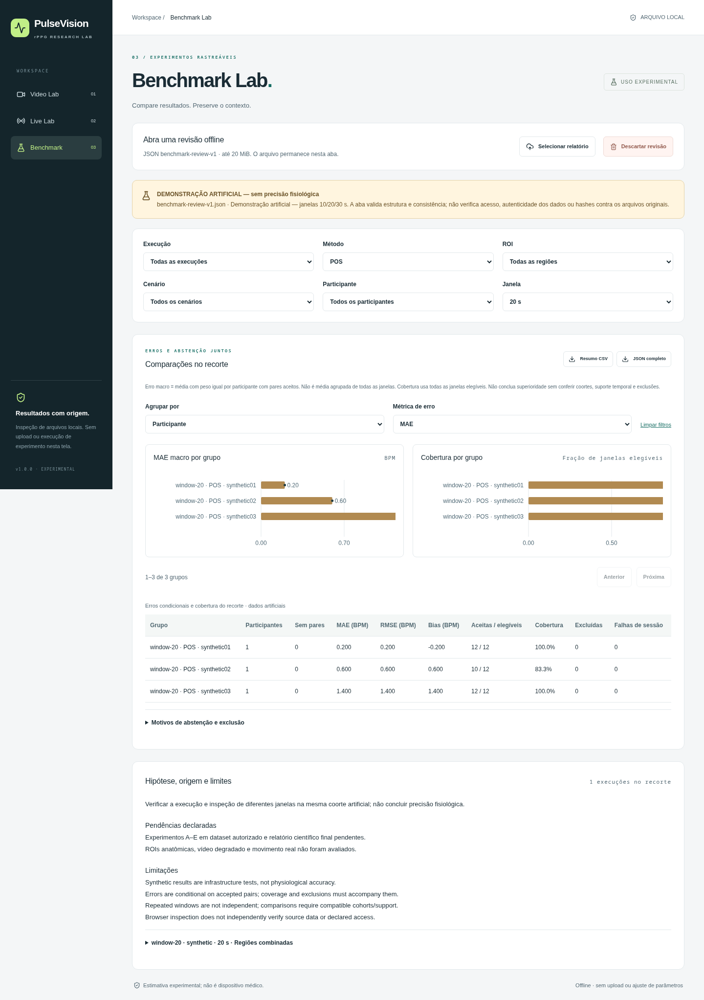
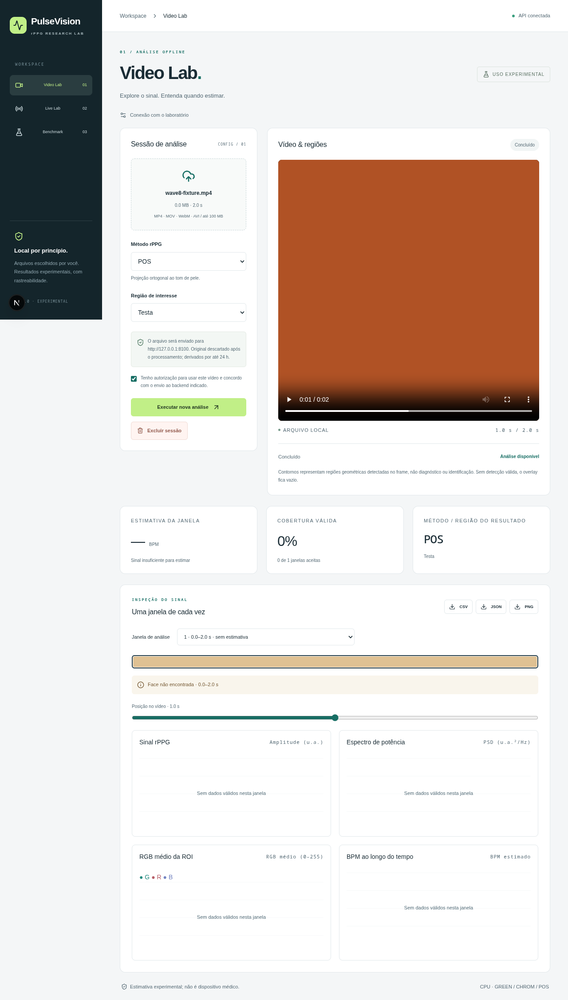

# PulseVision — rPPG Lab

Experimental, local-first tools for inspecting facial colour traces and estimating
pulse periodicity with GREEN, CHROM and POS. Insufficient evidence produces an
explicit abstention, with its reason and time window preserved.

**v1.0.0 is a local engineering milestone. No human accuracy or clinical validation
has been demonstrated. Authorized dataset evaluation is still pending.**

[Português](README.pt-BR.md) · [Linux setup](docs/release/linux.md) ·
[Research report](docs/research/report.md) · [Release notes](docs/release/v1.0.0.md)

## Try it locally

Requirements: Linux, uv 0.12.24, Node.js 24 and npm. uv manages Python 3.12 separately
from the system Python. Run from this repository:

```bash
uv python install 3.12
uv sync --locked
npm ci
# Explicit downloads of verified model/runtime assets:
uv run python scripts/fetch_face_model.py
npm run live:assets
```

In separate terminals:

```bash
uv run uvicorn services.api.app.main:app --host 127.0.0.1 --port 8000 --workers 1
```

```bash
npm run dev -w apps/web
```

Open http://localhost:3000. Video Lab previews locally and uploads only after
explicit authorization. Live Lab starts the camera on request and processes frames
in a browser worker without transmitting them. Benchmark Lab imports offline JSON
locally. A camera is optional. Model weights are not bundled in Git or container images.

Optional isolated containers, alternate ports, camera permissions, retention and
shutdown are explained in the [Linux guide](docs/release/linux.md).

## Synthetic demonstration

```bash
uv run python -m benchmarks.study demo --output artifacts/my-synthetic-study
```

Import `artifacts/my-synthetic-study/results/review/benchmark-review-v1.json` in
`/benchmark`. This runs the actual offline pipeline on artificial RGB/reference
signals; its numbers do not estimate human accuracy. Existing output is never overwritten.
For an automated, face-free recording: `npm run demo` (see [demo notes](docs/release/demo.md)).





## Structure

- `packages/rppg_core`: acquisition with real PTS, ROIs, RGB, DSP and quality gates.
- `packages/rppg_types`: Pydantic contracts, JSON Schema and generated TypeScript.
- `services/api`: local FastAPI jobs with one supervised subprocess and bounded storage.
- `apps/web`: Next.js Video, Live and Benchmark Labs.
- `benchmarks`: access records, frozen protocols, adapters, evaluation and reports.
- `docs/adrs`: durable decisions. `AGENTS.md`, `state.md` and `CHANGELOG.md` guide work.

## Verification

```bash
uv run ruff check .
uv run mypy
uv run pytest
npm run format:check
npm run lint
npm run typecheck
npm test
NEXT_TELEMETRY_DISABLED=1 npm run build
npx playwright install chromium
npm run test:e2e
```

Regenerate contracts after changing models with `uv run python scripts/export_schemas.py`
and `npm run contracts`; do not edit generated files. Browser tests prepare verified
local assets explicitly and use an artificial camera, never a physical webcam.

## Limits and responsible use

No diagnosis, clinical ranges, SpO2 or facial identification. No authorized UBFC/PURE
copy is available here; protocol execution, positive ROI inspection on authorized
faces, real camera/mobile tests and external validation remain pending. Sampling,
motion, lighting, compression, skin appearance and reference alignment can affect
results. Error must be interpreted alongside coverage and abstention.

Uploads stay in a dedicated local store: source videos are deleted at terminal job
states; derived outputs expire after 24 hours by default. Explicit deletion is also
available. Downloads and imported source files remain under the user's control.
Do not expose this research service to the internet or share its API key.
See the [privacy policy](docs/privacy/policy.md), [security review](docs/security/wave11.md),
[dataset access record](docs/research/dataset-access.md) and [MIT license](LICENSE).
Dataset/model rights are separate from the software license.
